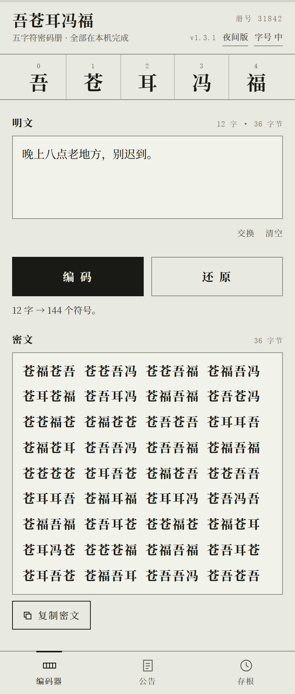
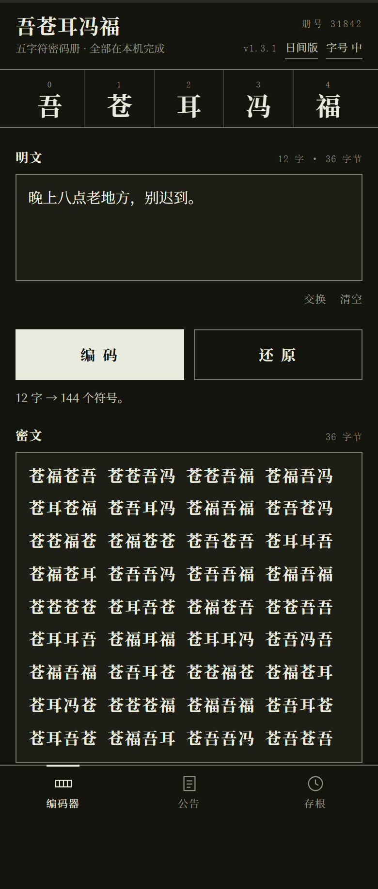
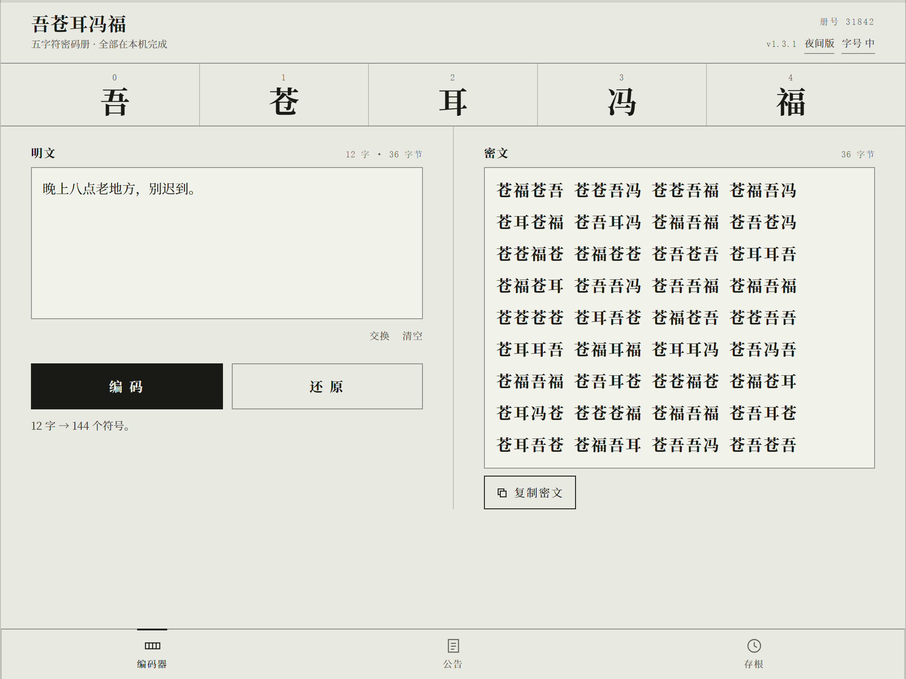

# 吾苍耳冯福 · 五字符密码册

把一段文字编成「吾苍耳冯福」五个字，再原样读回来。
这个项目灵感来源于我的同学
适配平板

一个 Android 单文件 WebView 应用（约 1.7 MB）：页面、字体、图标全部内嵌，**运行时零网络，
清单里不申请任何权限**，不注册、不上传、不需要服务器。

<p align="center">
  
  
  
</p>

<p align="center">
  <sub>手机单栏 · 夜间版 · 平板宽屏时摊成两页（左写右读）</sub>
</p>

## 这是什么

把文字拆成 UTF-8 字节，每个字节写成 4 位五进制，用五个字表示：

| 字 | 吾 | 苍 | 耳 | 冯 | 福 |
|---|---|---|---|---|---|
| 数值 | 0 | 1 | 2 | 3 | 4 |

「苍」在 UTF-8 里是三个字节 `E8 8B 8D`，于是写成十二个符号：

```
苍 → E8       8B       8D
   → 苍福苍耳  苍吾耳福  苍吾冯苍
```

于是密文长度永远等于「字节数 × 4」，四个符号是半个汉字，十二个符号正好一个汉字，
可以无损往返。

> **这不是加密。** 没有密钥、没有密码学强度，任何人拿到密文都能还原。它是个暗号玩具喵，
> 请不要用它保存或传输密码、隐私、商业机密。

## 功能

- **编码 / 还原**：明文或密文都行，密文按四个一组排成栅格。
- **一键复制**：结果下方「复制密文 / 复制明文」，标签跟着结果类型走。
- **存根**：本地历史最多 50 条，编号 `NO.001` 起，可载入、复制、**导出为 txt**、删除。
- **分享互通**：别的应用里选中文字 → 分享 → 吾苍耳冯福，像密文就还原、否则编码；
  结果页眉的「发给朋友」直接调系统分享面板。
- **撤销**：清空、交换、删除存根之后六秒内可撤回。
- **字号三档**：小 / 中 / 大，全页字号一起缩放。
- **日间 / 夜间**：纸色与墨色互换。
- **首次使用须知**：五条免责声明，同意才能进入。
- **离线**：不申请任何权限，不联网、不写外部存储、不读剪贴板历史。

## 下载

从 [Releases](../../releases) 下载最新的 `wucangerfengfu.apk`，传到手机上安装
（需要允许「安装未知来源应用」）。


## 自己构建

工具链只有四样：

- JDK 17（只用 `javac` 和 `java`）
- Android SDK **build-tools 34.0.0**（提供 `aapt2`、`zipalign`、`apksigner`、`d8.jar`）
- Android **platform 34** 的 `android.jar`
- Windows PowerShell 5.1+（脚本是 `.ps1`）

```powershell
# 指向你的 Android SDK（或把它放在项目根目录的 .android-sdk/）
$env:ANDROID_HOME = 'C:\path\to\android-sdk'

powershell -NoProfile -ExecutionPolicy Bypass -File .\build.ps1
# 产物：.\wucangerfengfu.apk（debug 签名，可直接侧载）
```

`build.ps1` 依次做六步：`aapt2 compile` 资源 → `aapt2 link` 打包（含 assets）→
`javac` → `d8` 出 dex → 塞进 apk、修正 asset 分隔符、`zipalign` → `apksigner` 签名。
第一次运行会自己生成 `debug.keystore`。

两个容易踩的点（脚本里已处理，改脚本时注意）：

- `aapt2` 在 Windows 上会把 `assets/fonts/x.otf` 写成 `assets\fonts\x.otf`，Android 的
  AssetManager 用 `/` 查找会 404，字体静默回退 —— 打包后必须把条目名里的 `\` 改回 `/`。
- `aapt2`/`zipalign` 是原生程序，按 ANSI 代码页接收参数，**SDK 路径不能含非 ASCII 字符**。

## 目录结构

```
.
├── app/
│   ├── AndroidManifest.xml                    # 包名、SEND 分享过滤器、零权限
│   ├── src/com/wcf/editor/MainActivity.java   # WebView 壳 + 四个 JS 桥
│   ├── res/                                   # 应用名、五种密度的图标
│   └── assets/
│       ├── index.html                         # 整个界面与编解码逻辑（单文件）
│       └── fonts/                             # 思源宋体子集 + OFL 许可
├── build.ps1                                  # 手工六步构建
├── make-icon.ps1                              # 生成启动图标（GDI+）
├── subset-font.py                             # 重新生成字体子集（需 fonttools）
├── dev/                                       # 开发期工具，不进 APK
│   ├── probe.mjs                              # 用 CDP 驱动无头 Chrome：截图与量化
│   ├── _shot.js                               # 场景化截图脚本
│   ├── _smoke.js                              # 功能回归（往返、报错、主题、存根）
│   └── _measure.js                            # 布局量化（是否横向溢出）
└── docs/
    ├── MANUAL.txt                             # 中英双语完整手册（原理/功能/构建/日志）
    ├── DEV-NOTES.md                           # 实现笔记：三处适配、布局上的三个坑
    └── img/                                   # 上面那几张截图
```

## 实现要点

界面是一张 HTML，壳只负责四件事 —— 都是 WebView 里跑不通、必须桥接到原生的地方：

| 页面里的调用 | WebView 里的问题 | 壳的处理 |
|---|---|---|
| `navigator.clipboard.writeText` | `file://` 文档经常被拒 | 重定向到 `ClipboardManager` |
| `window.close()` | 被静默忽略 | 映射到 `Activity.finish()` |
| `<a download>` 存 txt | 不会真的落盘 | `ACTION_CREATE_DOCUMENT` 系统保存框 |
| 「发给朋友」/ 分享进来 | 没有系统入口 | `ACTION_SEND` + `SEND` 过滤器 |

其余（五进制编解码、`localStorage`、须知弹层、撤销、字号）全是页面自己的 JS。

字体是思源宋体（Noto Serif SC）的子集：把页面用到的字符 + GB2312 一级字（3755 字）
切出来，两个字重合计约 2.2 MB，`file://` 直接加载，不依赖系统字体。

## 已知限制

- **没有真机长期验证**：本机没有 adb 也没有模拟器，只做了静态校验（签名、dex、资源、
  zipalign 对齐、asset 字节比对）与 Chromium 里的布局/功能回归。真机上若有异常，欢迎提 issue。
- 使用 **debug 签名**，侧载没问题；要上架或长期分发请用自己的正式密钥重签。
- 图标是普通方图，没做 Android 8+ 的自适应图标（前景/背景分层）。
- 密文长度是原文的 4 倍，长文在聊天软件里会很长 —— 目前没有分段功能。

## License

代码以 [MIT](LICENSE) 发布。内置字体是 Noto Serif SC 的子集，遵循
[SIL Open Font License 1.1](app/assets/fonts/OFL.txt)。

## 致谢

灵感来自聂某、徐某；界面与代码在 ChatGPT6 / DeepSeek v4.1 Flash 的协助下完成。
有bug欢迎反馈：guoshinia@outlook.com
bilibiliuid:3546587399719598
www.youtube.com/@HatMaury-k6g

---

## English

**Wucangerfengfu** (吾苍耳冯福) is a tiny Android app that encodes any text into five
Chinese characters and back. Each UTF-8 byte becomes four base-5 digits, and the digits
0–4 map to 吾 苍 耳 冯 福 — so the cipher is exactly 4 characters per byte and
round-trips losslessly.

It is **not encryption**: no key, no cryptographic strength, anyone can decode it.

One HTML file in a WebView shell, with a few native bridges (clipboard, `window.close`,
saving a .txt, share in/out). No network, no permissions, no server, no Gradle —
`build.ps1` drives `aapt2 → javac → d8 → zipalign → apksigner` by hand.

See [`docs/MANUAL.txt`](docs/MANUAL.txt) for the full bilingual manual.
Licensed under MIT; the bundled Noto Serif SC subset is under the SIL OFL 1.1.
